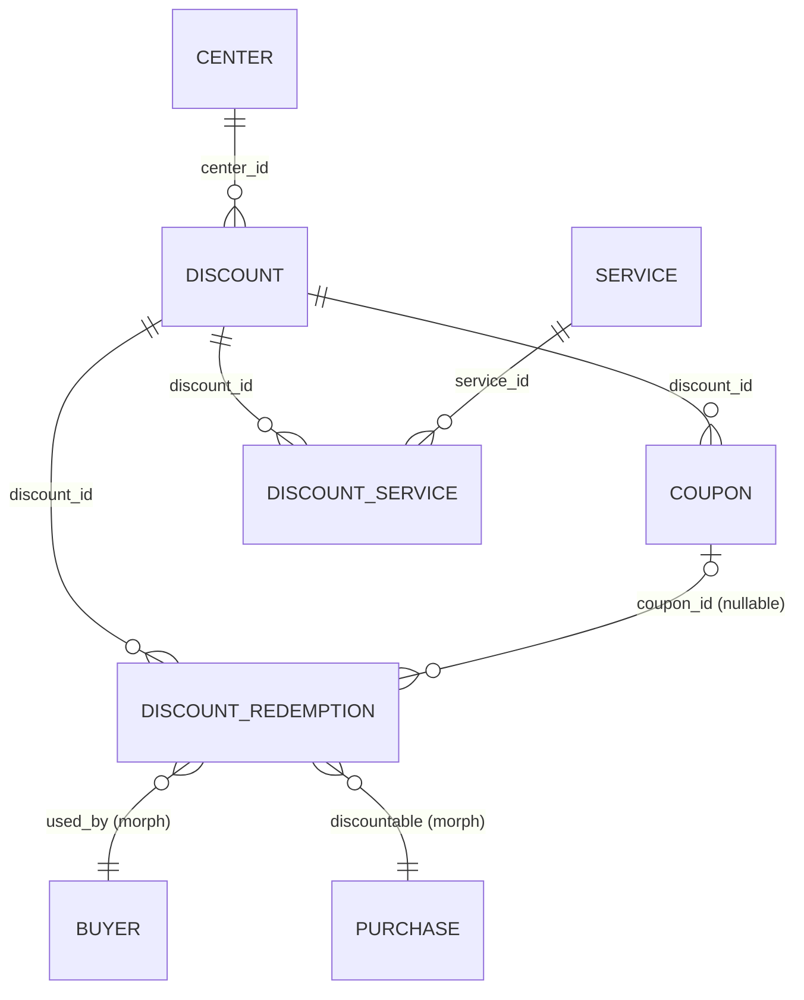
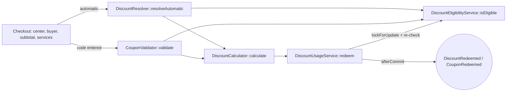

# Promotion Module — Technical Review

> Scope: everything under `modules/Promotion/` plus its touch points in `Centers`, `Services`, `Purchase`, `composer.json`, `bootstrap/providers.php` and `phpunit.xml`.
> Date: 2026-10-11 · Branch: `develop` · Laravel 12 / PHP 8.4 / Pest
> Tests: **49 passed, 172 assertions** (`php artisan test --compact modules/Promotion/tests`)

---

## 1. Acceptance criteria

| # | Criterion | Status | How it is enforced |
|---|-----------|--------|--------------------|
| AC-1 | Discounts and coupons belong **only to a center**. | ✅ | `discounts.center_id` FK → `centers` (cascade). There is no polymorphic owner and no Platform owner, and the admin endpoints were removed. Coupons belong to a discount, so they belong to its center. Routes are `centers/{center}/discounts/...` with scoped bindings. `CenterPolicy::manageDiscounts` allows assigned center users only. `CouponValidator` and `DiscountResolver` require a `Center`. |
| AC-2 | Only **Services** (`modules/Services`) are discountable. | ✅ | `discount_service` pivot with a `service_id` FK → `services` (cascade). `Discount::services()` is a `BelongsToMany`, and `Service` uses `HasDiscountable`. `AttachServicesRequest` only accepts non-deleted services of the route center. Eligibility matches on service ids. |

Feature tests that prove the criteria: [tests/Feature/CenterDiscountTest.php](tests/Feature/CenterDiscountTest.php).

---

## 2. TL;DR

The Promotion module is a **discount & coupon engine for centers**. A center defines **Discounts** (percentage or fixed, automatic or coupon-based, for all services or for specific services). A discount can have many **Coupons**, can be restricted to specific **Services**, and every use is recorded as a **DiscountRedemption** under a row lock.

### Still open

| # | Severity | Finding |
|---|----------|---------|
| 1 | 🟠 High | The engine is not wired into any purchase or booking flow (§9.1). |
| 2 | 🟠 High | `DiscountCalculator` applies `specific_items` discounts to the **whole subtotal**, not to the matching services' line totals (§9.2). |
| 3 | 🟡 Medium | `is_stackable` is stored but never enforced (§9.3). |
| 4 | 🟡 Medium | Coupon creation: no uniqueness validation, no collision retry, up to 100k inserts in a request (§9.4). |
| 5 | 🟡 Medium | `UpdateDiscountRequest` date-rule edge cases (§9.5). |
| 6 | 🟡 Medium | `DiscountLimitExceededException` covers every ineligibility case and renders as a 500 (§9.6). |

### Fixed by the center-only refactor

| Earlier finding | Resolution |
|---|---|
| Admin routes accepted any Sanctum token (`auth:sanctum`). | Admin controller and routes removed. Routes use `auth:center_user` + `center.scope` + `CenterPolicy::manageDiscounts`. System users are denied. |
| `store`, `couponsStore`, `index`, `couponsIndex` had wrong return types, and `couponsStore` called `loadCount()` on a plain `Collection`, so all returned 500. | Return types corrected and an Eloquent collection used. Covered by feature tests. |
| Platform owner key `'platform'` stored in a bigint `owner_id`, which strict MySQL rejects. | Polymorphic owner replaced by `center_id`. |
| Coupons were not tenant-scoped, so one center's coupon worked at another. | `CouponValidator::validate($code, Center $center, …)` only finds coupons of that center. `resolveAutomatic(Center $center, …)` is required. |
| `specific_items` matched `PurchaseItem` models against the pivot, so redeem always failed. | Matching uses service ids. `redeem()` takes an explicit `$services` argument. |
| `discountables` accepted any type string and any id. | It is now a typed `service_id` FK, validated against the center's non-deleted services. |
| Center owner taken from `$user->centers()->first()` (non-deterministic). | The center comes from the `{center}` route parameter and is authorized by policy. |
| Admin and center controllers were ~95% duplicated. | Only the center controller remains. |
| No Feature tests. | `CenterDiscountTest` added (9 tests). |

---

## 3. Module layout

```
modules/Promotion/
├── database/
│   ├── factories/        Coupon, Discount, DiscountRedemption
│   └── migrations/       discounts, coupons, discount_redemptions, discount_service
├── lang/{en,ar}/validation.php
├── routes/center.php     /api/v1/centers/{center}/discounts/*
├── src/
│   ├── Enums/            ApplicationMethod, DiscountScope, DiscountType, PromotionStatus
│   ├── Events/           DiscountCreated, DiscountRedeemed, CouponRedeemed
│   ├── Exceptions/       DiscountLimitExceededException
│   ├── Http/
│   │   ├── Controllers/Center/DiscountController.php
│   │   ├── Requests/     AttachServices, StoreDiscount, UpdateDiscount, UpdateDiscountStatus,
│   │   │                 StoreCoupon, UpdateCouponStatus
│   │   └── Resources/    Discount/Coupon Resource + Collection
│   ├── Models/           Discount, Coupon, DiscountRedemption
│   ├── Services/         DiscountCalculator, DiscountEligibilityService,
│   │                     CouponValidator, DiscountResolver, DiscountUsageService
│   ├── Traits/           HasDiscounts (Center), HasDiscountable (Service),
│   │                     HasDiscountRedemptions (Purchase, PurchaseItem)
│   └── PromotionServiceProvider.php
└── tests/
    ├── Feature/CenterDiscountTest.php
    └── Unit/             9 files
```

**Bootstrapping.** `PromotionServiceProvider` is registered in `bootstrap/providers.php`. In `boot()` it loads migrations and the `promotion::` translations, and registers `routes/center.php` under the `api` middleware with the `api/v1` prefix. This matches the Services and Centers modules.

---

## 4. Domain model



### 4.1 `discounts`

| Column | Type | Notes |
|---|---|---|
| `center_id` | FK → `centers`, cascade | Owner. The only kind of owner. |
| `name`, `description` | json | Translatable `{en, ar}`, cast to `array`. |
| `type` | enum `percentage\|fixed` | `DiscountType` |
| `value` | decimal(14,2) | Percent or fixed amount. |
| `scope` | enum `all\|specific_items` | `specific_items` → restricted to attached services. |
| `application_method` | enum `automatic\|coupon` | |
| `minimum_amount` | decimal nullable | Inclusive lower bound on subtotal. |
| `maximum_discount` | decimal nullable | Cap. Percentage only. |
| `usage_limit` / `usage_limit_per_customer` | uint nullable | Global and per-buyer caps. |
| `is_stackable` | bool | Not enforced yet. |
| `starts_at` / `ends_at` | timestamp / nullable | Validity window. |
| `status` | enum `active\|in_active` | |

### 4.2 `coupons`

`discount_id` (FK, cascade), `code` (globally unique, stored upper-case), and its own `starts_at`/`ends_at`/`status`.

### 4.3 `discount_service`

A plain pivot with `discount_id` and `service_id`, both FKs with cascade, unique together. Its migration is dated `2026_10_11_140000` so it runs after the `services` table exists. A soft-deleted service stays attached in the pivot, but it cannot be newly attached.

### 4.4 `discount_redemptions`

The usage ledger. `discount_id` and `coupon_id` have FK restrict. `used_by` is a morph for the buyer. `discountable` is a morph for the record the discount was applied to, e.g. a `Purchase`. Also stores `discount_amount` and `redeemed_at`.

> The `discountable_*` columns name the **transaction** a redemption belongs to. They do not name a discount target. Discount targets are always services, through `discount_service`.

### 4.5 Traits

| Trait | Adds | Used by |
|---|---|---|
| `HasDiscounts` | `discounts(): HasMany` | `Centers\Models\Center` |
| `HasDiscountable` | `discounts(): BelongsToMany` (via `discount_service`) | `Services\Models\Service` |
| `HasDiscountRedemptions` | `discountRedemptions(): MorphMany` | `Purchase\Models\Purchase`, `PurchaseItem` |

---

## 5. Service layer



Every method that takes `$services` accepts `iterable<Service|int>`, i.e. `Service` models or service ids.

### 5.1 `DiscountEligibilityService::isEligible(Discount, ?Model $user, $subtotal, $services): bool`

The checks run in order and stop at the first failure:

1. Status is active.
2. `starts_at <= now` and `ends_at` is null or `>= now`.
3. `subtotal >= minimum_amount` (inclusive, if set).
4. Global `usage_limit` not reached.
5. Per-customer limit not reached. Skipped when `$user` is null.
6. If the scope is `specific_items`: at least one given service id is attached to the discount.

### 5.2 `DiscountCalculator::calculate(Discount, $items, $subtotal): float`

- **Fixed** → `value`.
- **Percentage** → `subtotal × value / 100`, capped at `maximum_discount`.
- The result is clamped to `[0, subtotal]` and rounded to 2 decimals.
- It ignores scope (see §9.2).

### 5.3 `CouponValidator::validate($code, Center $center, ?$user, $subtotal, $services): array`

The code is normalised with `trim` + upper-case. The lookup is restricted to coupons whose discount belongs to `$center`. It returns `valid: true` with `coupon` and `discount`, or one of these failures: `coupon_not_found` (404, also returned for another center's coupon), `coupon_inactive`, `coupon_expired`, `discount_ineligible` (422).

### 5.4 `DiscountResolver::resolveAutomatic(Center $center, ?$user, $subtotal, $services): Discount[]`

Returns the center's active, in-window automatic discounts that pass `isEligible`, ordered by `id`. It does not apply any stacking or best-discount logic.

### 5.5 `DiscountUsageService::redeem(Discount, Model $usedBy, Model $discountable, $amount, ?Coupon, $subtotal, $services): DiscountRedemption`

Inside a transaction it locks the discount row (`FOR UPDATE`), re-checks eligibility with the given services, inserts the redemption and dispatches the events after commit. If any check fails it throws `DiscountLimitExceededException`.

---

## 6. HTTP API

Prefix: `/api/v1/centers/{center}/discounts`. Middleware: `api`, `auth:center_user`, `center.scope`. Bindings are scoped: `{discount}` must belong to `{center}`, `{coupon}` must belong to `{discount}`, and `{service}` must be attached to `{discount}`. A mismatch returns 404. Every action authorizes with `CenterPolicy::manageDiscounts` (403 for users not assigned to the center and for system users).

| Method | Path | Action | Notes |
|---|---|---|---|
| GET | `/` | `index` | Filters: `status`, `type`, `scope`, `application_method`. 25 per page. Includes `coupons_count`, `redemptions_count`, `services_count`. |
| POST | `/` | `store` | 201. `center_id` is always taken from the route, never from the body. |
| GET | `/{discount}` | `show` | Includes `service_ids`. |
| PUT | `/{discount}` | `update` | |
| DELETE | `/{discount}` | `destroy` | 204. 422 if it has redemptions. |
| PATCH | `/{discount}/status` | `updateStatus` | |
| GET | `/{discount}/coupons` | `couponsIndex` | `?status=`, 50 per page. |
| POST | `/{discount}/coupons` | `couponsStore` | 201. `coupons[]` and/or `generator{prefix, quantity, length, starts_at, ends_at}`. |
| DELETE | `/{discount}/coupons/{coupon}` | `couponsDestroy` | 204. 422 if redeemed. |
| PATCH | `/{discount}/coupons/{coupon}/status` | `couponsUpdateStatus` | |
| POST | `/{discount}/services` | `servicesAttach` | `{"services": [ids]}`. Center's non-deleted services only. Idempotent. Returns the discount. |
| DELETE | `/{discount}/services/{service}` | `servicesDetach` | 204. 404 if not attached. |

**Example: discount limited to two services**

```http
POST /api/v1/centers/12/discounts
{ "name": {"en": "Riding week", "ar": "أسبوع الركوب"}, "type": "percentage", "value": 15,
  "scope": "specific_items", "application_method": "automatic", "starts_at": "2026-10-15" }

POST /api/v1/centers/12/discounts/{id}/services
{ "services": [41, 42] }
```

> **Breaking change for API clients:** `/api/center/discounts/*` and `/api/admin/discounts/*` are gone. The new paths are `/api/v1/centers/{center}/discounts/*`, and the old `discountables` endpoints are replaced by `services`.

---

## 7. Integration points

| Where | What |
|---|---|
| `bootstrap/providers.php` | Registers `PromotionServiceProvider`. |
| `Centers\Models\Center` | `use HasDiscounts`. |
| `Centers\Policies\CenterPolicy` | `manageDiscounts()`: assigned center users only. |
| `Services\Models\Service` | `use HasDiscountable`. |
| `Purchase\Models\Purchase`, `PurchaseItem` | `use HasDiscountRedemptions`. Both have a `discount_amount` column. |

---

## 8. Tests

| File | Covers |
|---|---|
| `Feature/CenterDiscountTest` | Auth (guest 401, unassigned user 403, system user 403). Create is owned by the route center even if the body sends another `center_id`. Index is center-only. Another center's discount gives 404. Coupon creation. Another discount's coupon gives 404. Attach/detach services (idempotent, 404 when not attached). Rejects foreign, unknown and soft-deleted services. |
| `Unit/CouponValidatorTest` | All failure reasons, case-insensitivity, **another center's coupon not found**. |
| `Unit/DiscountEligibilityServiceTest` | Status, window, inclusive minimum, global and per-user limits, specific services (models and ids). |
| `Unit/DiscountResolverTest` | Filtering, center isolation, eligibility, ordering. |
| `Unit/DiscountUsageServiceTest`, `ConcurrencyTest` | Persisted amount, after-commit events, limit exhaustion. The concurrency test runs sequentially and SQLite ignores `FOR UPDATE`, so the lock itself is not exercised. |
| `Unit/ModelStructureTest` | Tables and columns, `center` relation, `services` pivot in both directions, unique code, enum casts. |
| `Unit/EnumTest`, `ScrambleAttributesTest` | Enum cases and API doc attributes. |

---

## 9. Open findings

### 9.1 🟠 Not wired into checkout
Nothing outside the module calls the services, and `purchases.discount_amount` is never filled by Promotion. The intended flow, inside the purchase transaction, is:
`resolveAutomatic` / `validate` → `calculate` → save the purchase with `discount_amount` → `redeem(..., $services)`.

### 9.2 🟠 Calculator ignores `specific_items`
A "15% off services 41, 42" discount takes 15% off the whole subtotal. `calculate()` should take the per-service line totals and discount only the matching ones.

### 9.3 🟡 `is_stackable` not enforced
`resolveAutomatic` returns every eligible discount. There is no rule for combining automatic and coupon discounts or for choosing the best one. A single `DiscountApplicator` entry point would be the natural place for this.

### 9.4 🟡 Coupon creation robustness
- No `unique:coupons,code` / `distinct` rule on manual codes. A duplicate causes a `QueryException` (500) and rolls back the batch.
- The generator has no collision retry, and creates up to 100k rows one by one inside the request. Chunked insert or a queued job would be needed.
- Codes are unique across all centers, so one center can find out that another center uses a code.

### 9.5 🟡 `UpdateDiscountRequest`
- `ends_at: after_or_equal:starts_at` fails when `starts_at` is not in the payload.
- Sending only `starts_at` can move it past the stored `ends_at`.
- `name.en` is not `required_with:name`.
- `type`, `value` and `scope` stay editable after redemptions exist.
- A percentage `value` has no `lte:100`.
- Switching `application_method` from coupon to automatic leaves live coupons that still validate.

### 9.6 🟡 Exceptions and messages
`DiscountLimitExceededException` is thrown for every ineligibility case with the "usage limit" message, and it has no `render()`. Several lang keys are unused. `StoreCouponRequest` uses an untranslated root string.

### 9.7 🟢 Minor
- N+1 `COUNT` queries per candidate in `resolveAutomatic`.
- `coupon_expired` is also used for "not started yet".
- Coupon generation and attach logic live in the controller rather than a service.
- `composer.json` declares a `Database\Seeders` path that does not exist.
- `.trae/specs/promotion-module/*` still describes the old polymorphic owner and discountables design.
